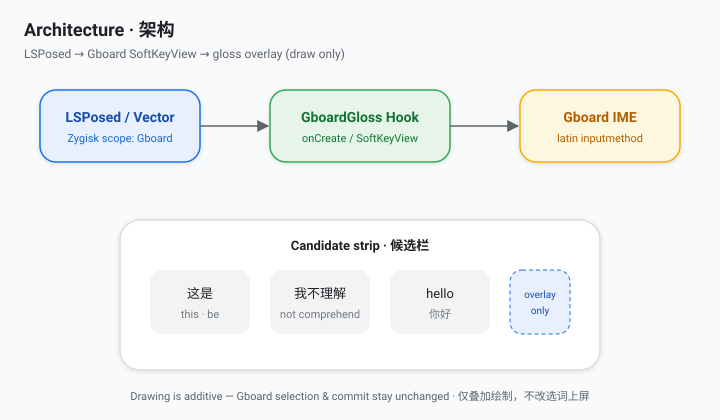
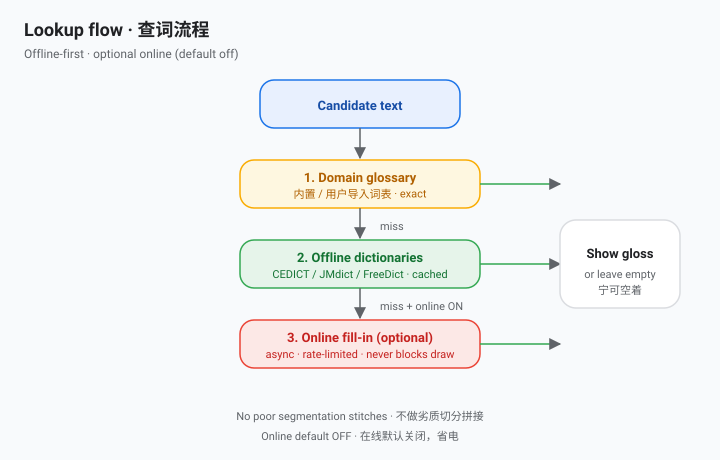
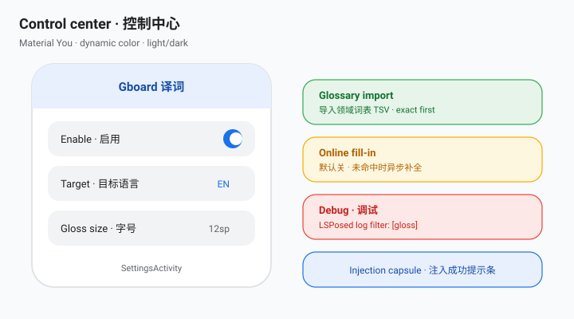

# GboardGloss：Gboard 候选词翻译 LSPosed 模块 | Inline translation for Gboard candidates (Xposed / LSPosed)

**中文** · [English](#english)

在谷歌输入法（Gboard）的候选词旁叠加显示目标语言译词，打字时顺便学外语。灵感来自 [青简 Qingjian](https://github.com/qingjian-team/qingjian)。

> **状态：** v0.3.2 — 包名 `io.github.ziyuw_plank.gboardgloss`（审核要求下划线）；概念图已加入 README。请卸载旧包后安装，并强停 Gboard。

### v0.3.2
- 包名按审核要求改为 `io.github.ziyuw_plank.gboardgloss`（GitHub 用户名中的连字符改为下划线）
- 重新提交 LSPosed / Vector 模块仓库

### v0.3.1
- 尝试包名 `io.github.ziyuwplank.gboardgloss` + 概念图（`docs/*.svg`）；审核要求下划线后在 0.3.2 修正
- 需卸载旧包 `com.zyw.gloss` 后重装


### v0.3.0
- 译词质量：仅展示可信的整词/词表命中；不再用劣质切分拼出译文
- 内置领域词表（科技/物理等），设置页可导入自定义 TSV；精确匹配优先于通用词典
- 视觉：候选下方次要标签、约 60% 透明度、跟随深浅色，避免刺眼对比色与拥挤重叠
- 长度：按完整词元截断，避免半截省略
- 可选在线补全（默认关）：离线未命中时异步请求并缓存，不阻塞绘制
- 性能：查词与绘制仍走缓存路径，在线请求限流

## 功能
- 仅作用于 Gboard（`com.google.android.inputmethod.latin`）的 LSPosed 模块
- 候选词下方叠加一行译词，只做绘制叠加，**不改变** Gboard 的选词、上屏和其他行为
- 自动识别源语言（按文字类型）
- 目标语言：英、中、日、德、法、西、俄；无直接词典时经英语中转
- 离线词典 + 领域词表；可选在线补全（默认关）
- Material You 控制中心：动态取色、深浅色、开关、语言、字号、词表导入
- 注入成功提示：屏幕底部胶囊条，几秒后淡出
- 调试模式，日志带 `[gloss]` 前缀

## 环境要求
- Android 8.1+（minSdk 27）
- Root（Magisk）+ LSPosed（Zygisk）
- Gboard（对照分析版本 18.4.1）


## 概念图
| 图 | 说明 |
|---|---|
| [架构](docs/architecture.svg) | LSPosed / Vector 注入 → Hook SoftKeyView → 候选栏叠加译词 |
| [查词流程](docs/lookup-flow.svg) | 领域词表 → 离线词典 → 可选在线补全（默认关） |
| [控制中心](docs/control-center.svg) | Material You 设置：开关、语言、字号、词表、在线、调试 |







## 模块仓库（LSPosed / Vector）
已收录：[modules.lsposed.org 模块页](https://modules.lsposed.org/module/io.github.ziyuw_plank.gboardgloss)（[仓库](https://github.com/Xposed-Modules-Repo/io.github.ziyuw_plank.gboardgloss)，[submission #2167](https://github.com/Xposed-Modules-Repo/submission/issues/2167)）。**Vector** 与 LSPosed 共用该远程列表。包名：`io.github.ziyuw_plank.gboardgloss`。

> 模块仓库的 **GitHub Description** 需在网页上手动设为 `GboardGloss`（API 无权限），否则可能不在列表显示。

## 安装与使用
1. 从 [Releases](https://github.com/ziyuw-Plank/gboard-gloss/releases) 下载 `GboardGloss-0.3.2.apk` 并安装
2. LSPosed 中启用模块，作用域勾选 Gboard（同时勾选模块本身，设置页才能显示状态）
3. 强行停止 Gboard
4. 打开 GboardGloss，选择目标语言；需要时可导入领域词表或打开在线补全
5. 在任意输入框打字，观察候选词下方的译词

## 领域词表
- 内置 `assets/glossary.tsv`（精确匹配，优先于通用词典）
- 模板：`assets/glossary.template.tsv`（`词条<TAB>译文`，UTF-8）
- 设置页「导入词表 TSV」写入用户词表；「清除已导入词表」可移除

## 故障排查
- 看不到译词：打开调试模式，在 LSPosed 日志中筛选 `[gloss]`，提 Issue 时附上日志和 Gboard 版本
- 没有注入提示：确认作用域已勾选 Gboard 并已强停 Gboard
- Gboard 更新后失效：Gboard 内部结构可能变化，请反馈版本号
- 专业术语仍不准：导入自定义词表，或（可选）开启在线补全

## 支持语言与词典
| 方向 | 来源 | 词条数 |
|---|---|---|
| zh → en | CC-CEDICT | 189,267 |
| en → zh | CC-CEDICT（反查） | 55,708 |
| ja → en | JMdict | 465,880 |
| en → ja | JMdict（反查） | 145,436 |
| de → en / en → de | FreeDict | 372,021 / 360,338 |
| fr → en / en → fr | FreeDict | 8,249 / 8,782 |
| es → en / en → es | FreeDict | 4,497 / 58,868 |
| ru → en / en → ru | FreeDict | 42,281 / 57,005 |

其他组合经英语中转。暂不支持韩语（缺少可自由使用的词典）。

## 构建
```bash
git clone https://github.com/ziyuw-Plank/gboard-gloss
cd gboard-gloss
python3 tools/build_dicts.py   # 可选：重新生成词典
./gradlew assembleRelease      # 需要 JDK 17 与 Android SDK
```

## 常见问题
**问：会影响 Gboard 正常输入吗？**
答：不会。模块只在候选词视图上额外绘制文字，不修改选词和上屏逻辑。

**问：需要联网吗？**
答：默认不需要。打开「在线补全」后，仅在离线未命中时才会请求网络。

**问：不 root 能用吗？**
答：不能，需要 root 和 LSPosed。

**问：支持哪些语言？**
答：中、英、日、德、法、西、俄之间互译（部分经英语中转）。

## 致谢与许可
- 灵感：[青简 Qingjian](https://github.com/qingjian-team/qingjian)
- 词典：CC-CEDICT、JMdict/EDRDG、FreeDict，详见 [THIRD_PARTY_NOTICES.md](THIRD_PARTY_NOTICES.md)
- 在线补全（可选）：MyMemory Translation API
- 许可：[GPL-3.0-or-later](LICENSE)。本项目与 Google 无关。

---

<a id="english"></a>
## English

### v0.3.2
- Package id → `io.github.ziyuw_plank.gboardgloss` (underscore per Modules-Repo bot; hyphenated GitHub usernames are invalid)
- Resubmitted to LSPosed / Vector module repository

### v0.3.1
- Package id change for [Xposed Module Repository](https://modules.lsposed.org) (LSPosed & Vector)
- Concept diagrams added under `docs/`
- Uninstall legacy `com.zyw.gloss` before installing


### v0.3.0
- Gloss quality: show only trusted whole-entry / glossary hits; no poor segmentation stitches
- Built-in domain glossary plus Settings import for custom TSV; exact matches beat the general dictionaries
- Visuals: soft secondary label under candidates (~60% alpha), light/dark aware; less crowding
- Length: truncate on token boundaries only
- Optional online fill-in (off by default): async + cached on offline miss; never blocks drawing
- Performance: cached lookup/draw path kept; online calls are rate-limited

GboardGloss shows a translation under each Gboard suggestion so you pick up vocabulary while you type. Inspired by [Qingjian 青简](https://github.com/qingjian-team/qingjian).

> **Status:** v0.3.2 — package id `io.github.ziyuw_plank.gboardgloss` (Modules-Repo rules); concept diagrams in README. Uninstall older builds, then force-stop Gboard.

### Features
- LSPosed module scoped to Gboard only (`com.google.android.inputmethod.latin`)
- Translation gloss drawn under candidates; purely additive, **never changes** Gboard behavior
- Automatic source language detection (by script)
- Targets: en, zh, ja, de, fr, es, ru, with English as pivot when needed
- Offline dictionaries + domain glossary; optional online fill-in (default off)
- Material You control center: dynamic color, toggles, language, size, glossary import
- Injection banner that fades out
- Debug mode with `[gloss]`-tagged logs

### Requirements
- Android 8.1+ (minSdk 27)
- Root (Magisk) + LSPosed (Zygisk)
- Gboard (analyzed against 18.4.1)


### Concept diagrams
| Diagram | What it shows |
|---|---|
| [Architecture](docs/architecture.svg) | LSPosed / Vector inject → SoftKeyView hook → gloss overlay |
| [Lookup flow](docs/lookup-flow.svg) | Glossary → offline dicts → optional online (default off) |
| [Control center](docs/control-center.svg) | Material You settings: enable, language, size, glossary, online, debug |


### Module repository (LSPosed / Vector)
Listed: [modules.lsposed.org page](https://modules.lsposed.org/module/io.github.ziyuw_plank.gboardgloss) ([repo](https://github.com/Xposed-Modules-Repo/io.github.ziyuw_plank.gboardgloss), [submission #2167](https://github.com/Xposed-Modules-Repo/submission/issues/2167)). **Vector** and LSPosed share that list. Package: `io.github.ziyuw_plank.gboardgloss`.

> Set the modules-repo GitHub **Description** to `GboardGloss` in the browser (API lacks permission) or it may stay hidden.

### Install & use
1. Download `GboardGloss-0.3.2.apk` from [Releases](https://github.com/ziyuw-Plank/gboard-gloss/releases) and install it
2. Enable the module in LSPosed and tick Gboard (tick the module itself too for settings status)
3. Force-stop Gboard
4. Open GboardGloss, pick a target language; optionally import a glossary or enable online fill-in
5. Type in any field and watch glosses under candidates

### Domain glossary
- Bundled `assets/glossary.tsv` (exact match, preferred over general dictionaries)
- Template: `assets/glossary.template.tsv` (`term<TAB>gloss`, UTF-8)
- Settings → Import TSV / Clear imported glossary

### Troubleshooting
- No gloss: enable debug, filter LSPosed logs for `[gloss]`, open an issue with logs and Gboard version
- No banner: confirm Gboard is in scope and was force-stopped
- Broke after a Gboard update: internals may have changed; report the version
- Technical terms still wrong: import a custom glossary, or optionally enable online fill-in

### Languages
See the table above. Other pairs go through English. Korean is not supported yet.

### Build
JDK 17 + Android SDK, then `./gradlew assembleRelease`.

### FAQ
**Does it affect normal typing?** No. It only draws extra text on candidate views.

**Does it need internet?** Not by default. Online fill-in only runs on offline misses when you turn it on.

**Does it work without root?** No. It needs root and LSPosed.

**Which languages?** Chinese, English, Japanese, German, French, Spanish, Russian (some pairs via English).

### Credits & license
Dictionaries: CC-CEDICT, JMdict/EDRDG, FreeDict — see [THIRD_PARTY_NOTICES.md](THIRD_PARTY_NOTICES.md). Optional online: MyMemory. Code licensed [GPL-3.0-or-later](LICENSE). Not affiliated with Google; Gboard is a trademark of Google LLC.

## Keywords
Gboard, Gboard translation, Gboard 翻译, 谷歌输入法, 谷歌输入法翻译, LSPosed, LSPosed module, Xposed module, Xposed 模块, 输入法翻译, 候选词翻译, bilingual candidates, 双语候选词, 外语学习, language learning keyboard, vocabulary learning, domain glossary, 领域词表, Android, root, Magisk, Zygisk, offline dictionary, 离线词典, CC-CEDICT, JMdict, FreeDict, Qingjian, 青简, Material You, online translation, 在线翻译, Vector, modules.lsposed.org, io.github.ziyuw_plank.gboardgloss, SoftKeyView, concept diagram
