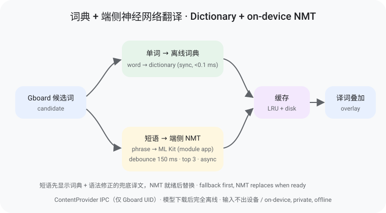

# GboardGloss：Gboard 候选词翻译 LSPosed 模块 | Inline translation for Gboard candidates (Xposed / LSPosed)

**中文** · [English](#english)

在谷歌输入法（Gboard）的候选词旁叠加显示目标语言译词，打字时顺便学外语。灵感来自 [青简 Qingjian](https://github.com/qingjian-team/qingjian)。

## 混合翻译原理
只靠词典逐词拼接，得到的只是单词堆叠，没有语法和语序。因此采用混合方案：

| 候选类型 | 处理方式 | 特点 |
|---|---|---|
| 第 1 个候选（首选） | 端侧神经网络机器翻译（ML Kit NMT）；失败时回退词典 | 整句理解，语法正确 |
| 第 2 个及以后 | 离线词典（CC-CEDICT、JMdict、FreeDict）+ 领域词表；词典未命中或只能拼接时才用 NMT | 同步、亚毫秒、省电 |

- **离线**：每种语言模型约 30 MB，下载一次后无需联网
- **隐私**：翻译在本机完成，输入内容不上传
- **省电**：异步 + 防抖（约 150 ms）+ 只翻前 3 个候选 + LRU/磁盘缓存；绘制路径只读缓存
- **兜底**：NMT 结果到达前先显示词典译文（带语法修正：否定、助动词、了、吗），到达后替换；NMT 不可用且语法没把握时短语留空
- **可观测**：缺模型时在 Wi-Fi 下自动下载；超时的翻译在后台继续并写入缓存，客户端稍后重试；设置页显示 Gboard 最近一次调用状态



**Android 11+ 可见性：** Gboard 需要能“看见”本模块的 ContentProvider。打开 GboardGloss 并在“试一试”输入框中用 Gboard 打几个字即可（系统会让输入法看见当前应用，重启后需再做一次）；或在 LSPosed 作用域中额外勾选“系统框架”并重启，永久生效（只对 Gboard 放行本模块）。

## 功能
- 仅作用于 Gboard（`com.google.android.inputmethod.latin`）的 LSPosed 模块
- 候选词下方叠加一行译词，只做绘制叠加，**不改变** Gboard 的选词、上屏和其他行为
- 自动识别源语言（按文字类型）
- 目标语言：英、中、日、德、法、西、俄；无直接词典时经英语中转
- 单词：离线词典 + 领域词表；短语：端侧神经网络翻译（ML Kit）；可选在线补全（默认关）
- Material You 控制中心：动态取色、深浅色、开关、语言、字号、词表导入
- 注入成功提示：屏幕底部胶囊条，几秒后淡出
- 调试模式，日志带 `[gloss]` 前缀

## 环境要求
- Android 8.1+（minSdk 27）
- Root（Magisk）+ LSPosed（Zygisk）
- Gboard（对照分析版本 18.4.1）

## 概念图
| 图 | 说明 |
|---|---|
| [混合翻译](docs/hybrid-pipeline.svg) | 首选候选 → 端侧 NMT；其余 → 词典（没把握再 NMT）→ 缓存 → 译词叠加 |
| [架构](docs/architecture.svg) | LSPosed / Vector 注入 → Hook SoftKeyView → 候选栏叠加译词 |
| [查词流程](docs/lookup-flow.svg) | 领域词表 → 离线词典 → 可选在线补全（默认关） |
| [控制中心](docs/control-center.svg) | Material You 设置：开关、语言、字号、词表、在线、调试 |


## 模块仓库（LSPosed / Vector）
已收录：[modules.lsposed.org 模块页](https://modules.lsposed.org/module/io.github.ziyuw_plank.gboardgloss)（[仓库](https://github.com/Xposed-Modules-Repo/io.github.ziyuw_plank.gboardgloss)，[submission #2167](https://github.com/Xposed-Modules-Repo/submission/issues/2167)）。**Vector** 与 LSPosed 共用该远程列表。包名：`io.github.ziyuw_plank.gboardgloss`。

## 安装与使用
1. 从 [Releases](https://github.com/ziyuw-Plank/gboard-gloss/releases) 下载最新的 `GboardGloss-*.apk` 并安装
2. LSPosed 中启用模块，作用域勾选 Gboard（同时勾选模块本身，设置页才能显示状态）
3. 强行停止 Gboard
4. 打开 GboardGloss，选择目标语言；需要时可导入领域词表或打开在线补全
5. 在任意输入框打字，观察候选词下方的译词

## 领域词表
- 内置 `assets/glossary.tsv`（精确匹配，优先于通用词典）
- 模板：`assets/glossary.template.tsv`（`词条<TAB>译文`，UTF-8）
- 设置页「导入词表 TSV」写入用户词表；「清除已导入词表」可移除

## 故障排查
- 看不到译词：打开调试模式，在 LSPosed 日志中筛选 `[gloss]`，提 Issue 时附上日志和 Gboard 版本
- 没有注入提示：确认作用域已勾选 Gboard 并已强停 Gboard
- Gboard 更新后失效：Gboard 内部结构可能变化，请反馈版本号
- 专业术语仍不准：导入自定义词表，或（可选）开启在线补全

## 支持语言与词典
| 方向 | 来源 | 词条数 |
|---|---|---|
| zh → en | CC-CEDICT | 189,267 |
| en → zh | CC-CEDICT（反查） | 55,708 |
| ja → en | JMdict | 465,880 |
| en → ja | JMdict（反查） | 145,436 |
| de → en / en → de | FreeDict | 372,021 / 360,338 |
| fr → en / en → fr | FreeDict | 8,249 / 8,782 |
| es → en / en → es | FreeDict | 4,497 / 58,868 |
| ru → en / en → ru | FreeDict | 42,281 / 57,005 |

其他组合经英语中转。暂不支持韩语（缺少可自由使用的词典）。

## 构建
```bash
git clone https://github.com/ziyuw-Plank/gboard-gloss
cd gboard-gloss
python3 tools/build_dicts.py   # 可选：重新生成词典
./gradlew assembleRelease      # 需要 JDK 17 与 Android SDK
```

## 常见问题
**问：会影响 Gboard 正常输入吗？**
答：不会。模块只在候选词视图上额外绘制文字，不修改选词和上屏逻辑。

**问：需要联网吗？**
答：默认不需要。打开「在线补全」后，仅在离线未命中时才会请求网络。

**问：不 root 能用吗？**
答：不能，需要 root 和 LSPosed。

**问：支持哪些语言？**
答：中、英、日、德、法、西、俄之间互译（部分经英语中转）。

## 致谢与许可
- 灵感：[青简 Qingjian](https://github.com/qingjian-team/qingjian)
- 词典：CC-CEDICT、JMdict/EDRDG、FreeDict，详见 [THIRD_PARTY_NOTICES.md](THIRD_PARTY_NOTICES.md)
- 在线补全（可选）：MyMemory Translation API
- 许可：[GPL-3.0-or-later](LICENSE)。本项目与 Google 无关。

---

<a id="english"></a>
## English

GboardGloss shows a translation under each Gboard suggestion so you pick up vocabulary while you type. Inspired by [Qingjian 青简](https://github.com/qingjian-team/qingjian).

### Hybrid translation
Stitching dictionary words together gives a pile of words, not a sentence: no grammar, no word order. So translation is hybrid:

| Candidate | Engine | Notes |
|---|---|---|
| Candidate #1 (top) | On-device NMT (ML Kit); dictionary if NMT fails | Understands the whole phrase, grammatical |
| Candidates #2+ | Offline dictionary + domain glossary; NMT only on a miss or a stitched phrase | Synchronous, sub-millisecond, battery-friendly |

- **Offline**: ~30 MB per language model, downloaded once
- **Private**: translation happens on the device; nothing you type is uploaded
- **Battery-friendly**: async + ~150 ms debounce + top-3 candidates only + LRU/disk cache; the draw path only reads cache
- **Fallback**: grammar-fixed dictionary gloss (negation, auxiliaries, aspect, questions) shows first, replaced when NMT returns; if NMT is unavailable and grammar is not confident, phrases stay blank
- **Observable**: missing models auto-download on Wi-Fi; timed-out translations finish in the background into the cache and the client retries; Settings shows Gboard's last call status


**Android 11+ visibility:** Gboard must be able to see the module's ContentProvider. Open GboardGloss and type a few characters with Gboard in the "try it" box (the system lets the IME see the app it is typing into; repeat after reboot), or additionally tick "System Framework" in the LSPosed scope and reboot for a permanent fix (it only unhides this module from Gboard).

### Features
- LSPosed module scoped to Gboard only (`com.google.android.inputmethod.latin`)
- Translation gloss drawn under candidates; purely additive, **never changes** Gboard behavior
- Automatic source language detection (by script)
- Targets: en, zh, ja, de, fr, es, ru, with English as pivot when needed
- Words: offline dictionaries + domain glossary; phrases: on-device NMT (ML Kit); optional online fill-in (default off)
- Material You control center: dynamic color, toggles, language, size, glossary import
- Injection banner that fades out
- Debug mode with `[gloss]`-tagged logs

### Requirements
- Android 8.1+ (minSdk 27)
- Root (Magisk) + LSPosed (Zygisk)
- Gboard (analyzed against 18.4.1)

### Concept diagrams
| Diagram | What it shows |
|---|---|
| [Hybrid pipeline](docs/hybrid-pipeline.svg) | top candidate → on-device NMT; others → dictionary (NMT if not confident) → cache → gloss overlay |
| [Architecture](docs/architecture.svg) | LSPosed / Vector inject → SoftKeyView hook → gloss overlay |
| [Lookup flow](docs/lookup-flow.svg) | Glossary → offline dicts → optional online (default off) |
| [Control center](docs/control-center.svg) | Material You settings: enable, language, size, glossary, online, debug |


### Module repository (LSPosed / Vector)
Listed: [modules.lsposed.org page](https://modules.lsposed.org/module/io.github.ziyuw_plank.gboardgloss) ([repo](https://github.com/Xposed-Modules-Repo/io.github.ziyuw_plank.gboardgloss), [submission #2167](https://github.com/Xposed-Modules-Repo/submission/issues/2167)). **Vector** and LSPosed share that list. Package: `io.github.ziyuw_plank.gboardgloss`.

### Install & use
1. Download the latest `GboardGloss-*.apk` from [Releases](https://github.com/ziyuw-Plank/gboard-gloss/releases) and install it
2. Enable the module in LSPosed and tick Gboard (tick the module itself too for settings status)
3. Force-stop Gboard
4. Open GboardGloss, pick a target language; optionally import a glossary or enable online fill-in
5. Type in any field and watch glosses under candidates

### Domain glossary
- Bundled `assets/glossary.tsv` (exact match, preferred over general dictionaries)
- Template: `assets/glossary.template.tsv` (`term<TAB>gloss`, UTF-8)
- Settings → Import TSV / Clear imported glossary

### Troubleshooting
- No gloss: enable debug, filter LSPosed logs for `[gloss]`, open an issue with logs and Gboard version
- No banner: confirm Gboard is in scope and was force-stopped
- Broke after a Gboard update: internals may have changed; report the version
- Technical terms still wrong: import a custom glossary, or optionally enable online fill-in

### Languages
See the table above. Other pairs go through English. Korean is not supported yet.

### Build
JDK 17 + Android SDK, then `./gradlew assembleRelease`.

### FAQ
**Does it affect normal typing?** No. It only draws extra text on candidate views.

**Does it need internet?** Only once, to download translation models (~30 MB each). After that everything runs on-device. The separate online fill-in stays off unless you turn it on.

**Does it work without root?** No. It needs root and LSPosed.

**Which languages?** Chinese, English, Japanese, German, French, Spanish, Russian (some pairs via English).

### Credits & license
Dictionaries: CC-CEDICT, JMdict/EDRDG, FreeDict — see [THIRD_PARTY_NOTICES.md](THIRD_PARTY_NOTICES.md). On-device NMT: Google ML Kit Translation (subject to the ML Kit terms). Optional online: MyMemory. Code licensed [GPL-3.0-or-later](LICENSE). Not affiliated with Google; Gboard is a trademark of Google LLC.

## Keywords
Gboard, Gboard translation, Gboard 翻译, 谷歌输入法, 谷歌输入法翻译, LSPosed, LSPosed module, Xposed module, Xposed 模块, 输入法翻译, 候选词翻译, bilingual candidates, 双语候选词, 外语学习, language learning keyboard, vocabulary learning, domain glossary, 领域词表, Android, root, Magisk, Zygisk, offline dictionary, 离线词典, CC-CEDICT, JMdict, FreeDict, jieba, Chinese word segmentation, 中文分词, phrase translation, 短语翻译, Qingjian, 青简, Material You, online translation, 在线翻译, Vector, modules.lsposed.org, io.github.ziyuw_plank.gboardgloss, SoftKeyView, concept diagram, neural machine translation, NMT, on-device translation, offline translation, ML Kit, ML Kit Translation, Google ML Kit, hybrid translation, grammar-aware translation, sentence translation, 神经网络翻译, 神经机器翻译, 端侧翻译, 离线翻译, 本地翻译, 混合翻译, 整句翻译, 隐私翻译
